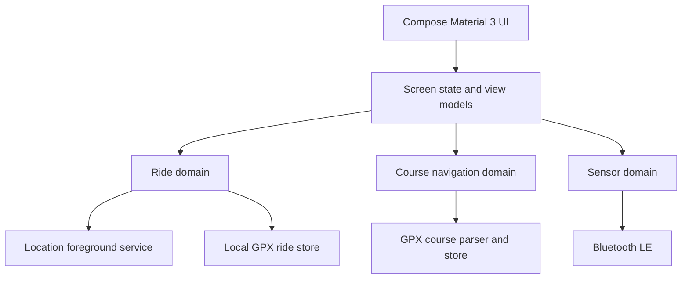

# Cyclocomp development plan

## Product intent

Cyclocomp is a lightweight, privacy-first cycling computer for a handlebar-mounted Android phone. It should make a rider's most important information legible at a glance, record rides reliably, follow GPX courses without needing a data connection, and work with common cycling sensors without unnecessary battery drain.

The reference product is Cyclemeter, but Cyclocomp is an independent Android-native implementation. It will use Google's Material 3 design system.

## Target and constraints

| Area | Decision |
| --- | --- |
| Primary device | Samsung Galaxy A70 running Android 11 |
| Platform | Native Android, Kotlin, Jetpack Compose, Material 3 |
| Minimum Android version | Android 8.0 (API 26) |
| Primary operating mode | Phone mounted on handlebars; outdoor rides; screen may be off |
| Data model | Local-first; rides and courses remain on the device by default |
| Mapping | Offline-friendly; no map or network dependency for recording |
| Sensors | Bluetooth LE first; ANT+ is a later integration |
| Apple Watch HR | Not a supported native Android sensor source; consider a bridge only as an experimental future feature |

The Galaxy A70 has no barometer, so elevation should come from GPS or later from an elevation data source. The design should not promise barometric accuracy on this phone.

## Product principles

- Fast to read while riding: large values, high contrast, minimal touch targets.
- Reliable over clever: never lose an active ride because the app moves to the background.
- Battery conscious: location only while a ride is active; no persistent scanning or polling.
- Private by default: no account required; export is deliberate.
- Useful without a network: recording, course following, ride history, and GPX export must work offline.

## Feature roadmap

### V1 — reliable cycling computer

This is the release baseline.

- Start, pause, resume, and end a ride.
- Record GPS track points at a battery-conscious cadence (normally one location update per second).
- Show current speed, moving time, distance, ride state, GPS quality, and an optional map/course view.
- Filter poor GPS points and auto-pause when stopped.
- Keep recording in a user-visible location foreground service while a ride is active.
- Save completed rides atomically as GPX files on-device.
- Import GPX courses through Android's document picker.
- Draw a course line, calculate distance to course, and show an off-course state.
- Discover standard Bluetooth LE heart-rate, cycling speed/cadence, and cycling-power sensors.
- Provide Material 3 Ride, Routes, History, Devices, and Settings surfaces.
- Export recorded ride GPX files through Android's share/save flow.

### V1.5 — training and connected data

- Connect to BLE sensors and subscribe to heart-rate, cadence, speed, and power measurements.
- Sensor preferences, reconnect behavior, and battery/status indicators.
- Data pages that riders can customize.
- Heart-rate and power zones; configurable audio announcements.
- Structured intervals, lap markers, and ride summaries with charts.
- Health Connect import/export where appropriate.
- Optional Strava sharing after explicit account connection.

### V2 — complete navigation

- Rendered offline map packs with native MapLibre.
- Saved routes and cue sheets.
- Turn instruction generation for imported routes where route geometry permits it.
- Route planning using a configurable routing provider.
- Online rerouting, with clear offline limitations.
- Offline route-following fallback: course line, distance from course, and return-to-course guidance.

### V3 — advanced Cyclemeter-style capabilities

- Live tracking with explicit share session, expiry, and privacy controls.
- Friend/rider radar and location sharing.
- Virtual competitor and pace targets.
- Training plans, richer coaching prompts, and achievements.
- Route and ride analytics across longer time ranges.
- Broader import/export formats: TCX, FIT, KML, and CSV, subject to dependency and licensing review.

## Current implementation status

| Area | Status |
| --- | --- |
| Compose Material 3 app shell | Implemented |
| GPS ride tracker, auto-pause, accuracy filtering | Implemented |
| Location foreground service | Implemented |
| GPX ride persistence and exportable files | Implemented |
| GPX import and simple off-course geometry | Implemented |
| BLE sensor discovery screen | Implemented |
| Route, history, and devices screens | Implemented as V1 surfaces |
| BLE sensor connection and data reads | Implemented in V1.5 |
| Custom data pages & HR zones | Implemented in V1.5 |
| GPX trackpoint extensions (HR, Cadence) | Implemented in V1.5 |
| Rendered/offline maps | Implemented in V2 |
| Turn directions and rerouting | Implemented in V2 |
| Cloud sharing, Strava, Health Connect | Planned later |

## Technical architecture

### Stack

| Concern | Choice |
| --- | --- |
| Language | Kotlin |
| UI | Jetpack Compose + Material 3 |
| Minimum SDK | 26; compatible with Android 11 target device |
| Build | Gradle, Android Gradle Plugin, JDK 17 |
| Ride processing | Small, testable Kotlin domain layer with no Android dependencies where practical |
| Location | Fused/platform location provider behind a location service boundary |
| Background tracking | Android location foreground service, active only during a ride |
| Routes and rides | GPX import/export; on-device storage |
| Persistence evolution | GPX files now; Room database for indexed metadata, settings, and richer history later |
| BLE | Android Bluetooth GATT standard profiles: Heart Rate, Cycling Speed and Cadence, Cycling Power |
| Maps | MapLibre Native with downloadable offline packs in V2 |
| Testing | JUnit for ride math and GPX/navigation logic; instrumented tests for Android boundaries |

## Android 11 compatibility policy

Android 11 uses legacy Bluetooth permissions and requires Location permission plus the phone's Location setting for BLE discovery. It does not use the Android 12+ "Nearby devices" runtime permission.

| Capability | Android 11 behavior |
| --- | --- |
| GPS ride recording | Ask for precise location before starting; run a location foreground service only for active rides |
| BLE scan | Require Location permission and the system Location setting enabled |
| BLE connect | Use legacy Bluetooth permissions declared up to API 30 |
| Notifications | No Android 13 notification runtime prompt; foreground-service notification is still shown |
| Background location | Avoid broad background-location permission; active ride tracking uses a foreground service initiated by the rider |

The manifest remains forward compatible by declaring Android 12+ Bluetooth permissions as well, while the legacy Bluetooth permissions are capped at API 30.

## Battery and reliability budget

| Situation | Policy |
| --- | --- |
| No active ride | No location updates, no foreground service, no sensor scans |
| Active ride | Location target: one update per second, with accuracy and distance filters |
| Screen off | Foreground service continues recording; UI work stops naturally |
| Map screen | Render at a lower update rate than location processing; avoid unnecessary redraws |
| BLE discovery | Scan only from the Devices flow and stop once a sensor connects or the screen exits |
| Route storage | Parse/import once, retain lightweight geometry/index data |
| Ride finalization | Close service safely and save GPX atomically to avoid a corrupt completed ride |

Real-device testing is mandatory: Android power management, GPS quality, and BLE behavior cannot be validated completely in an emulator.

## Key user flows

### Record a ride

1. Rider opens **Ride** and taps **Start**.
2. App checks precise location permission and starts the visible foreground tracking service.
3. Dashboard shows speed, distance, moving time, GPS quality, and state.
4. Auto-pause responds to a sustained stop; rider can manually pause or resume.
5. Rider taps **End**, reviews the result, and the GPX file is saved locally.

### Follow a route

1. Rider imports a GPX file from Files, Downloads, or a sharing app.
2. The app parses the route and saves a local course entry.
3. Rider selects the course before starting a ride.
4. The app compares live GPS points with the course geometry.
5. The UI reports on-course/off-course and distance from the course; V2 adds rendered maps and turn guidance.

### Add a sensor

1. Rider opens **Devices** and starts a scan.
2. On Android 11, the app asks for Location permission if needed and reminds the rider that system Location must be enabled.
3. Discovered standard BLE sensors appear by type.
4. V1.5 lets the rider connect, verify live data, assign the sensor to a bike/profile, and set reconnect rules.

## UI structure and wireframe intent

| Screen | Main content | Riding priority |
| --- | --- | --- |
| Ride | Large metric tiles, status strip, start/pause/end controls, course/map entry | Highest: glanceable in sunlight and motion |
| Routes | Imported courses, start action, route details | Select before a ride; no dense editing on the bike |
| History | Ride list, totals, ride detail, GPX share/export | Review after the ride |
| Devices | Sensor scan, discovered devices, connected status | Setup before the ride |
| Settings | Units, auto-pause, GPS/battery behavior, privacy, data pages | Configuration away from the road |

Material 3 use includes dynamic color only when legibility remains strong, large touch targets, dark-theme dashboard support, semantic labels, and screen-reader-friendly state changes. Critical riding states must not depend on color alone.

## Data, privacy, and safety

- Local-first by default; no login or cloud sync in V1.
- GPX is portable and user-controlled. Exports use Android's normal document/share workflows.
- Live tracking or third-party sharing must be off by default and require explicit session-level consent.
- Store only the data necessary for the feature. Explain location use immediately before recording or scanning.
- Avoid operating-system accessibility workarounds or hidden background behavior. The active tracking notification is intentional.
- Do not encourage interaction while moving: large controls, minimal modal dialogs, optional audio/haptic feedback for important events.

## Acceptance criteria for V1

- A rider can install the app on the Galaxy A70 running Android 11.
- A rider can grant precise location, start a ride, lock the screen, and retain an accurate GPS track.
- Manual pause/resume, end, and auto-pause work without corrupting the route or moving time.
- A completed ride appears in History and is saved as valid GPX.
- A GPX course can be imported and selected; the app detects a meaningful off-course condition.
- A standard BLE HR, cadence/speed, or power sensor can be discovered when Android 11 Location is enabled.
- The app performs no ride tracking or sensor scan after the rider ends the ride or leaves Devices.
- Core ride calculations and GPX navigation parsing are covered by unit tests.

## Delivery sequence

1. Stabilize V1 on the Galaxy A70: build, permissions, GPS, screen-off ride recording, GPX import/export, and BLE discovery.
2. Add real BLE connections and measurements, then configurable data pages.
3. Add offline map rendering and navigation cues.
4. Add training metrics, intervals, charts, and optional health/social integrations.
5. Add advanced sharing, planning, and coaching only after the reliability and privacy foundations are proven.

## V1.5 Development Checklist

- [x] **BLE Sensor Connection & GATT Client Implementation**
  - [x] Implement `BleSensorConnectionManager` to manage GATT connections, reconnection, and disconnects.
  - [x] Implement GATT binary parsers for Heart Rate (UUID 0x180D / 0x2A37), Cycling Speed & Cadence (UUID 0x1816 / 0x2A5B), and Cycling Power (UUID 0x1818 / 0x2A63).
  - [x] Implement unit tests for BLE packet parsers (8-bit vs 16-bit HR, CSC wheel/crank deltas, Power measurement).
- [x] **Sensor Integration into Core Ride Domain & GPX Persistence**
  - [x] Extend `RideMetrics` and `RidePoint` to record live `heartRateBpm`, `cadenceRpm`, `powerWatts`.
  - [x] Update `RideTracker` to compute average/maximum Heart Rate, Cadence, and Power.
  - [x] Update `RideFileStore` to export Garmin GPX trackpoint extension format (`gpxtpx:TrackPointExtension` with `<gpxtpx:hr>` and `<gpxtpx:cad>`).
- [x] **Devices Screen & Sensor Management UI**
  - [x] Allow connecting and disconnecting sensors directly from `DevicesScreen`.
  - [x] Show live sensor connection status, RSSI signal, and live data telemetry in `DevicesScreen`.
  - [x] Save paired sensor devices to preferences for auto-reconnect on ride start.
- [x] **Ride Dashboard & Custom Data Pages UI**
  - [x] Add Heart Rate, Cadence, and Power metric cards to `RideScreen`.
  - [x] Add HR zone indicator (Zone 1-5) based on current heart rate.
  - [x] Support data page switching on `RideScreen` (Primary Metrics, Sensor Telemetry, Course Navigation).
- [x] **History & Ride Export UI**
  - [x] Add ride detail view in `HistoryScreen` showing summary stats (distance, time, avg/max speed, avg/max HR, avg power).
  - [x] Add GPX share action (`Intent.ACTION_SEND`) to share recorded ride files with other apps.
- [x] **Automated Testing & Build Verification**
  - [x] Run `./gradlew test` and verify 100% pass rate for new BLE parsers, ride domain, and GPX store logic.

## V2 Development Checklist

- [x] **Real-time Map & Location Display**
  - [x] Add `Osmdroid` dependency for offline tile caching and high-contrast map rendering.
  - [x] Create `MapViewComposable` wrapper with live location marker and follow-location auto-centering.
- [x] **Active Route & Live Track Polyline Overlays**
  - [x] Render imported GPX active route polyline on the map with Start and Finish markers.
  - [x] Draw live recorded ride track polyline in real-time as the rider moves.
- [x] **Turn Guidance & Cue Sheet Generation**
  - [x] Implement bearing calculations and turn direction generator (`TurnType` and `TurnCue`) in `GpxNavigation.kt`.
  - [x] Display floating turn guidance overlay on `MapViewComposable` during ride navigation.
  - [x] Display interactive route map preview on `RoutesScreen`.

## Development and testing checklist

- Use Android Studio with JDK 17 and Android SDK Platform 35.
- Use the physical Galaxy A70 for GPS and Bluetooth testing; the emulator is sufficient only for basic UI checks.
- Enable Developer options and USB debugging, connect by a data-capable USB cable, then select the phone as the run target.
- For Android 11 BLE discovery, turn on the phone's Location system setting.
- Test a short outdoor ride with screen off, a traffic-stop auto-pause, a GPX course, and each available sensor type.
- Check the saved GPX with another GPX viewer before calling a release build reliable.
- Record battery percentage before and after a representative one-hour ride and compare after each location/map/sensor change.

## Explicit non-goals for the first release

- Guaranteed turn-by-turn navigation or offline rerouting.
- Apple Watch heart-rate pairing directly to Android.
- Cloud account, social feed, or automatic publication of location.
- Full Cyclemeter parity on day one.
- Medical-grade heart-rate, power, speed, or elevation claims.
